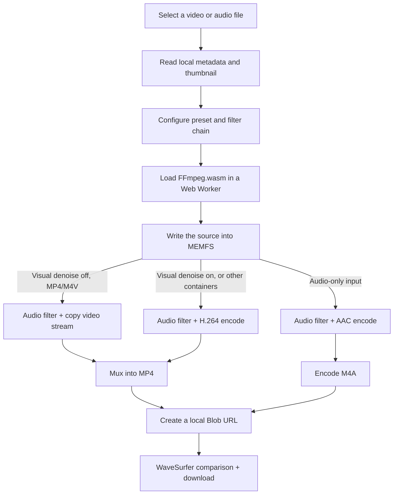

# 🎙️ NoiseGone — Client-Side Video & Audio Noise Reduction

[](https://opensource.org/licenses/MIT)
[](https://vite.dev/)
[](https://ffmpeg.org/)
[](https://github.com/arqam66/noise_reduction)

**NoiseGone** removes audio hiss, hum, and video grain entirely in the browser. Video and audio files up to **1 GB** are processed locally with **FFmpeg.wasm** — no accounts, no backend, and no media uploads.

> **Privacy:** Your media never leaves the device. The denoising engine itself is downloaded from `unpkg.com` the first time it is needed (then served from the browser cache), so media processing is local but the first run requires network access. See [Deployment](#-deployment) for a fully self-hosted/offline setup.

---

## ✨ Features

- **Video and audio input:** MP4, MOV, MKV, WebM, AVI, MP3, WAV, M4A, AAC, FLAC, OGG, and Opus.
- **Video output:** MP4 with H.264 video and AAC audio.
- **Audio output:** AAC in an M4A container.
- **Five presets:** Light, Standard, Aggressive, Voice-Only, and Film Grain.
- **Optional visual denoising:** Spatial/temporal (`hqdn3d`) or non-local means (`nlmeans`).
- **Fast audio-only path:** MP4/M4V sources can copy the original video stream (`-c:v copy`) while only the audio is filtered. Other containers are re-encoded so the resulting MP4 plays correctly in browsers.
- **Real cancellation:** cancelling terminates the FFmpeg worker, frees its memory, and returns to the settings screen.
- **Before/after preview:** WaveSurfer.js waveforms with independent playback controls.
- **Progress and ETA:** worker progress, phase text, and an accessible progress bar.
- **Large-file guardrails:** 1 GB hard limit, warnings above 500 MB, and a best-effort low-memory warning on Chromium (`navigator.deviceMemory`).

### Audio filters

NoiseGone combines FFmpeg's adaptive FFT denoiser (`afftdn`) with frequency isolation:

- **High-pass filter** (`highpass=f=80`–`100`) removes rumble, handling noise, and AC hum below the vocal range.
- **Low-pass filter** (`lowpass=f=8000`–`12000`) rolls off hiss and high-frequency static.
- **Adaptive noise tracking** (`tn=1`) follows a changing background noise profile.
- **Voice-Only** uses the Wiener method (`nt=w`) for stronger vocal isolation.

---

## 🛠️ Architecture & Data Flow



1. **Local metadata:** an `<audio>`/`<video>` element reads duration and dimensions; a canvas captures a small thumbnail for video. Failures are non-fatal.
2. **Background worker:** FFmpeg.wasm runs in a Web Worker so the interface stays responsive. This project uses the **single-threaded** `@ffmpeg/core` build, so `SharedArrayBuffer` and COOP/COEP headers are **not** required.
3. **MEMFS:** the source file is written into FFmpeg's in-memory filesystem. The filtered output is read back as a `Blob`.
4. **Cleanup:** MEMFS files are deleted after each run. Cancelling terminates the worker instead, which releases the whole WASM heap. Blob URLs are revoked when the user resets the tool.

---

## ⚙️ Presets

| Preset | Audio filter | Video filter | Use case |
| :--- | :--- | :--- | :--- |
| **🌤 Light** | `highpass=f=80,afftdn=nr=15:nf=-45:tn=1` | `hqdn3d=1:1:2:2` | Quiet rooms with faint hiss. |
| **⚡ Standard** | `highpass=f=80,afftdn=nr=25:nf=-40:tn=1,lowpass=f=12000` | `hqdn3d=3:3:6:6` | Webcam or desk microphone. |
| **🔥 Aggressive** | `highpass=f=100,afftdn=nr=35:nf=-35:tn=1,lowpass=f=10000` | `hqdn3d=6:6:10:10` | Wind, air conditioners, grainy phone footage. |
| **🎙 Voice-Only** | `highpass=f=100,afftdn=nt=w:nr=30:nf=-35:tn=1,lowpass=f=8000` | *(disabled)* | Interviews, podcasts, lectures. |
| **🎬 Film Grain** | `highpass=f=80,afftdn=nr=18:nf=-40:tn=1` | `nlmeans=s=3:r=7:p=3` | Vintage footage with sensor grain. |

Voice-Only suppresses visual processing while the preset is active. It does **not** overwrite the stored visual toggle, so switching back to another preset restores the user's choice. Audio-only files never show the visual toggle.

---

## 🚀 Local Development

### Prerequisites

- **Node.js 22.18+** (Node 24 LTS is used in development; the unit tests rely on Node's native TypeScript type stripping)
- **npm 10+**

### Install and run

```bash
npm install
npm run dev
```

Open `http://localhost:5173`.

### Production build

```bash
npm run build
npm run preview
```

### Tests

```bash
# Pure helper tests (Node's built-in test runner + native TypeScript support)
npm run test:unit

# Browser end-to-end tests (Playwright)
npm run test:e2e

# Both
npm test
```

Playwright starts the Vite dev server automatically on port 5173. The video specs use the local `_qa/noisy.mp4` clip and skip automatically when that fixture is absent. The audio spec generates its own WAV in the test output directory.

---

## 🌐 Deployment

The single-threaded FFmpeg core uses ordinary WebAssembly and Web Workers, so static hosting works without cross-origin isolation headers. A Content-Security-Policy must allow:

- `script-src` for the app bundle;
- `connect-src https://unpkg.com` while the core is fetched (or self-host the core and change `CORE_BASE_URL` in `src/lib/ffmpeg.ts`);
- `worker-src 'self' blob:` for the FFmpeg worker and blob-based core URLs.

### Fully offline / self-hosted core

Copy `ffmpeg-core.js` and `ffmpeg-core.wasm` from `@ffmpeg/core@0.12.6/dist/esm` into `public/ffmpeg/`, then change `CORE_BASE_URL` in `src/lib/ffmpeg.ts` to `/ffmpeg`. The app then has no runtime third-party requests.

### Multi-threaded core (optional)

If you switch to `@ffmpeg/core-mt`, serve the app with:

```http
Cross-Origin-Opener-Policy: same-origin
Cross-Origin-Embedder-Policy: require-corp
```

and verify the host supports `SharedArrayBuffer`. The default build does not need this.

---

## 🧠 Memory Behavior (Files Up to 1 GB)

Client-side processing is memory-bound. The source is copied into FFmpeg's WASM heap, the output is written alongside it, and a JavaScript `Blob` is created for download. Plan for roughly **2–4× the file size** in free memory.

NoiseGone mitigates this by:

- **Hard limit:** files above 1 GB are rejected before processing.
- **Warnings:** files above 500 MB show a memory warning; Chromium's approximate `navigator.deviceMemory` is used to warn on low-memory devices for files above 100 MB.
- **Single copy of output:** the result is exposed as a Blob URL rather than base64, avoiding a 33% encoding overhead.
- **Explicit cleanup:** MEMFS input/output files are deleted after each run; Blob URLs are revoked on reset; cancellation terminates the worker and releases its heap.

If a run fails with an out-of-memory error, try a shorter clip, a lower resolution, the Light preset, or closing other tabs.

---

## 💬 FAQ

#### Are my files uploaded anywhere?

No. Media is read and processed locally. The FFmpeg engine is fetched from `unpkg.com` on first use; no media is ever sent to that host.

#### Can I process audio-only files?

Yes. MP3, WAV, M4A, AAC, FLAC, OGG, and Opus inputs are supported and exported as AAC in an M4A container. Visual denoising is skipped automatically.

#### Why is visual denoising slower?

Audio is a one-dimensional signal processed with FFTs. Video frames are 2D grids that must be filtered spatially and across frames, which is much more CPU-intensive in WebAssembly. Turning visual denoising off lets MP4/M4V sources copy the video stream untouched.

#### How do I cancel a run?

Click **Cancel** during processing. The worker is terminated, partial output is discarded, and the settings screen returns. You can change presets and start again immediately.

#### Which formats are supported?

Video: MP4, MOV, MKV, WebM, AVI. Audio: MP3, WAV, M4A, AAC, FLAC, OGG, Opus. Video is exported as MP4 (H.264/AAC); audio is exported as M4A (AAC). Container/codec support ultimately depends on the FFmpeg.wasm build and the browser's decoders.

#### Why does my preview say "Preview unavailable"?

WaveSurfer decodes audio through the Web Audio API. Some containers (for example certain AVI/MKV codecs) cannot be decoded for preview even though FFmpeg can process them. Download the result to listen to it.

---

## 👨‍💻 Creator & License

Designed and built with ❤️ by [**arqam66**](https://github.com/arqam66).

Licensed under the [MIT License](LICENSE). Fork it, customize it, and build on it.
